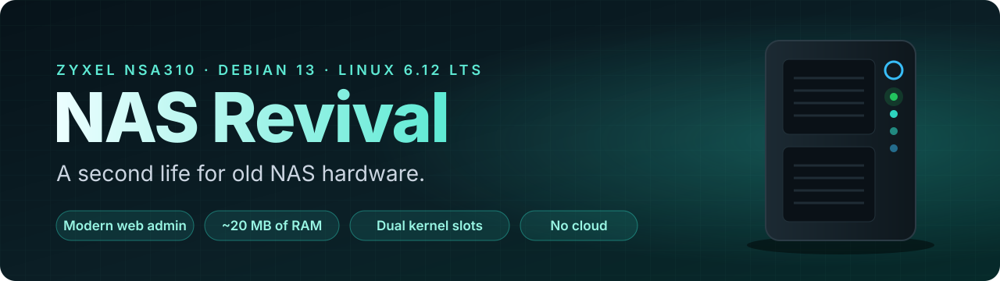
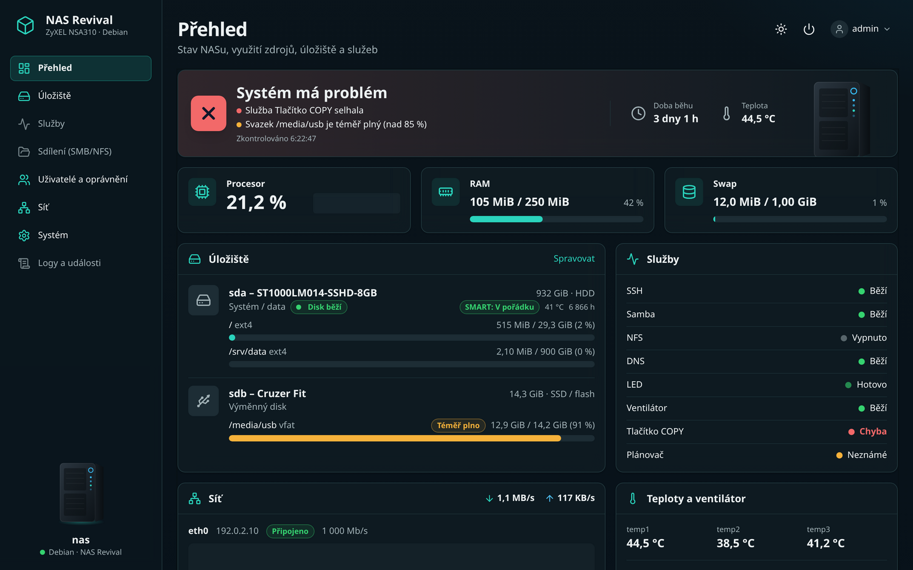
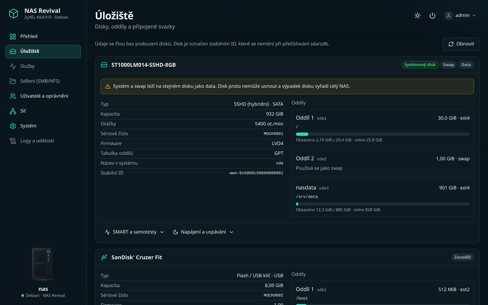
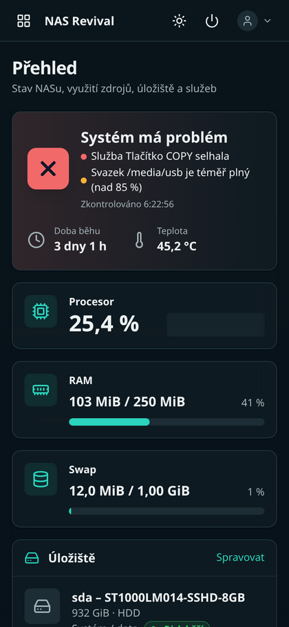
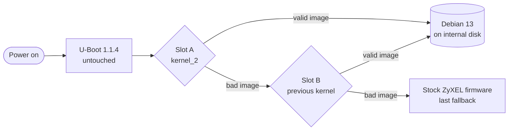

<p align="center">
  
</p>

<p align="center">
  
  
  
  
  
  
</p>

<p align="center">
  <b>Your 2010 NAS deserves better than a dead vendor firmware.</b><br>
  NAS Revival turns the ZyXEL NSA310 into a current Debian 13 server with its own maintained kernel<br>
  and a fast, modern web administration that idles in about 20 MB of RAM.
</p>

<p align="center">
  <a href="docs/debian/install.md"><b>📀 Install guide</b></a> ·
  <a href="#-features">✨ Features</a> ·
  <a href="#-safe-by-design">🛟 Recovery</a> ·
  <a href="docs/ROADMAP.md">🗺️ Roadmap</a>
</p>

---

<p align="center">
  
</p>

<p align="center"><sub>Dashboard in demo mode (<code>npm run dev:mock</code>) – the health panel flags a failed service and a nearly full volume. The UI is in Czech for now, English is planned.</sub></p>

## 🤔 Why

The NSA310 has a perfectly fine 1.2 GHz Kirkwood CPU, gigabit Ethernet and a SATA bay – and a vendor
firmware frozen around Linux 2.6.31, with Telnet, an outdated SMB stack and no updates. NAS Revival
replaces the software, not the hardware:

- **Current and patched** – Debian 13 "trixie" with security updates, Linux 6.12 LTS built by this project.
- **Light** – the whole web admin is one static Go binary (~10 MB RSS idle, plus a ~10 MB root helper). No Node.js, no containers,
  no database on the NAS.
- **Recoverable** – two kernel slots in NAND plus the untouched stock firmware as a last fallback.
- **Local** – no cloud account, no telemetry, no default password, nothing exposed to the Internet.

## ✨ Features

| | Feature | State |
| --- | --- | :---: |
| 🩺 | **Dashboard** – health check with a list of problems, CPU/RAM/swap, temperatures, network graph, services | ✅ |
| 💽 | **Storage** – disks by stable ID, partitions, usage, system-disk warnings | ✅ |
| 🔬 | **SMART** – attributes with highlights, self-test history, start short/long tests from the browser | ✅ |
| 🌙 | **Disk power** – sleep/APM profiles, "sleep now", reads state without waking the disk | ✅ |
| 🔎 | **Disk activity** – which process and which file keeps your disk from sleeping | ✅ |
| 🌐 | **Network, DNS, NTP, TLS certificate** – with **automatic rollback** after 180 s if you lock yourself out | ✅ |
| 🕓 | **Configuration history** – every change versioned, diff and revert | ✅ |
| 👥 | **Users and groups** – create, disable, passwords, membership | ✅ |
| 🔁 | **Reboot / shutdown** – pre-flight check (running SMART test, apt, pending network change) | ✅ |
| 🌀 | **Hardware** – automatic fan control (LM85), front LEDs, **COPY button** backs up a USB stick | ✅ |
| 📱 | Responsive UI, dark and light theme | ✅ |
| 🔐 | Multiple admin accounts and roles | 🚧 |
| 📂 | SMB / NFS / SFTP shares | 🚧 |
| 💾 | Backups, kernel updates from the web, boot-once for new kernels | 🗺️ |

Full list with acceptance criteria: [FEATURE_MATRIX](docs/FEATURE_MATRIX.md).

<table>
  <tr>
    <td width="72%"></td>
    <td width="28%"></td>
  </tr>
  <tr>
    <td align="center"><sub>Storage – stable disk IDs, partitions, SMART and power panels</sub></td>
    <td align="center"><sub>Works on a phone</sub></td>
  </tr>
</table>

## 📀 Flash your NSA310 – in short

> [!IMPORTANT]
> This writes to the NAND flash of your device. You **need a 3.3 V USB–serial adapter** and should
> read the **[full install guide](docs/debian/install.md)** first. U-Boot itself is never modified and
> the stock firmware stays bootable.

```text
 ① backup ─▶ ② build ─▶ ③ disk + stick ─▶ ④ test boot ─▶ ⑤ write slots ─▶ ⑥ boot chain ─▶ ⑦ web UI
```

1. **Console & backup.** Connect the adapter to header **J2** (115200 8N1, never connect 3.3 V),
   stop U-Boot, save `printenv` and dump all 9 NAND partitions with OOB.
2. **Build** on a Linux workstation:
   ```sh
   scripts/debian/build-kernel.sh                  # Linux 6.12 LTS + appended NSA310 device tree → uImage
   NAS_MAC=<ethaddr> scripts/debian/build-rootfs.sh \
     output/kernel/modules-6.12.119.tar.gz ~/.ssh/id_ed25519.pub   # Debian 13 armel root FS
   ```
3. **Prepare** the SATA disk (GPT: 30 GB root, 1 GB swap, data) and a USB stick (MBR, ext2, `uImage`).
4. **Test boot from RAM** – nothing is written; power off and the stock firmware is back:
   ```
   usb start
   ext2load usb 0:1 0x2000000 /uImage
   setenv bootargs console=ttyS0,115200 root=PARTUUID=<root> rootwait rw
   bootm 0x2000000
   ```
5. **Write the kernel** from the running Debian into NAND slot A (`/dev/mtd7`) and slot B
   (`/dev/mtd8`), verifying each with a read-back.
6. **Save the boot chain** with a single `saveenv`: slot A → slot B → stock firmware.
7. **Install the web UI** (`scripts/webui/build.sh`, [deploy guide](deploy/debian/README.md)) and open
   `https://<nas>:8443`.

## 🛟 Safe by design



- Every NAND write is verified by reading it back; Linux and U-Boot use byte-identical ECC.
- Network changes from the web roll back automatically unless confirmed from the new address.
- Privileged changes go through a small root helper that accepts only validated operations – the
  web server itself runs unprivileged.
- Everything the UI changes is a plain text file with a snapshot, revertible from SSH too.

What breaks and how to get back: [RECOVERY.md](docs/RECOVERY.md).

## 🔧 Hardware

| Device | State |
| --- | --- |
| **ZyXEL NSA310** (88F6281 A1 @ 1.2 GHz, 256 MB RAM, RTL8111D, LM85, 128 MB NAND) | ✅ in daily use |
| NSA310b, NSA310S, NSA320, other Kirkwood NAS | ❓ not tested – similar, but not the same hardware |

Verified capabilities per device: [HARDWARE_COMPATIBILITY](docs/HARDWARE_COMPATIBILITY.md).
Have another box? Issues with a boot log and `cat /proc/mtd` are welcome.

## 🧱 Under the hood

```text
backend/    Go: API server (unprivileged) + root helper over a Unix socket, HAL, SMART, disk power
frontend/   React + TypeScript + Vite + Tailwind, built on the workstation and embedded into the binary
deploy/     systemd units and NAS scripts (fan, LEDs, COPY button), base system tuning
scripts/    kernel, root FS and web UI builds; U-Boot console helpers; NAND ECC check
docs/       architecture, ADRs, API, security model, recovery, test plan, roadmap
```

Build and test the web UI: `scripts/webui/build.sh` (Go + Node via nvm). Try the UI without a NAS:
`cd frontend && npm ci && npm run dev:mock` – log in with any user name and password `demo`.

Before the first commit in a clone: `git config core.hooksPath scripts/git-hooks`. The pre-commit hook
refuses SSH keys, `known_hosts`, `.env` files, device dumps and your home path; site-specific patterns
(real subnets, host names) go into `~/.config/nas-revival/private-patterns`, never into the repo.
Test it with `bash tests/test_pre_commit.sh`.

| Read next | |
| --- | --- |
| [Install guide](docs/debian/install.md) | Step-by-step flashing of a stock NSA310 |
| [Boot layout](docs/debian/boot.md) | NAND slots, U-Boot environment, writing kernels |
| [Architecture](docs/ARCHITECTURE.md) | Process model, modules, config manager, HAL |
| [Release](docs/RELEASE.md) | Reproducible release build, manifest, local signing |
| [Security model](docs/SECURITY_MODEL.md) | Trust boundaries, privileged helper, auth |
| [API v1](docs/api/v1.md) | Administration API contract |
| [Roadmap](docs/ROADMAP.md) · [Web roadmap](docs/WEB_ROADMAP.md) | What comes next |

## 📜 License

Project code and documentation are [MIT licensed](LICENSE). The Linux kernel, Debian packages and other
upstream components keep their own licenses. Not affiliated with ZyXEL. Flashing is at your own risk.
