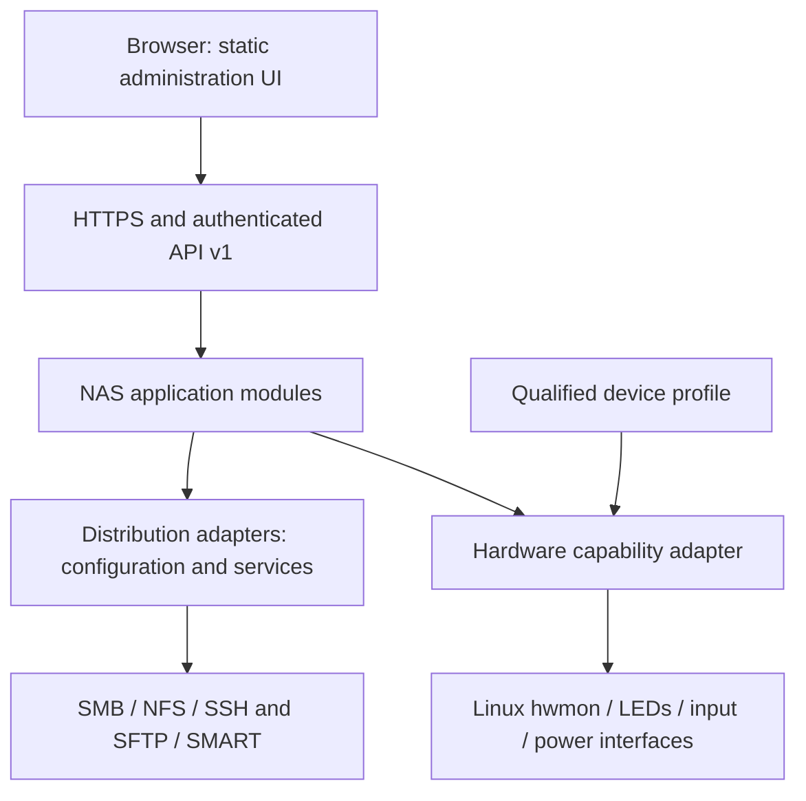

# Architecture overview

Status: design, not implementation. The base is conditional on [ADR-0001](../adr/0001-base-distribution.md).

The browser renders the interface and talks to a versioned NAS API. It never sends arbitrary shell commands, sysfs paths or ubus object names. OpenWrt-specific transport remains inside an adapter. A future Buildroot port must implement those adapters; portability is an explicit boundary, not a claim that rpcd is distribution-independent.

## Modules and persistence

| Module | Responsibility |
| --- | --- |
| System | Bounded snapshots of CPU, RAM, network, logs and service health |
| Identity | Users/groups, administrator sessions and per-action authorization |
| Shares | SMB/NFS/SFTP configuration and filesystem permissions; no guest access by default |
| Storage | Stable disk identity, read-only inventory first, explicit mount/unmount/create operations later |
| Hardware | Qualified capabilities and thermal safety independent of the web process |
| Network | Interface configuration with validate/apply/confirm and timed rollback |
| Configuration | Versioned export/import, validation, bounded archive extraction and atomic replacement |
| Update | Signed artifact validation, compatibility checks and a qualified recovery method |

Use distribution-native configuration through an adapter; no database server is planned. Writes should validate the full proposed state, serialize operations, create a recoverable configuration version and atomically replace files. A partially successful filesystem operation must not be represented as rolled back just because its configuration was restored.

Keep user data separate from OS/configuration. Until the existing JBOD layout is understood, do not import, mount or repair it automatically. An existing filesystem must never trigger initialization. ext4 is an initial candidate, not an established on-disk format on this unit.

## Proposed resource budgets

These are qualification targets, **not measured values or promises**; report RSS/PSS, MemAvailable and peaks with exact versions and workload.

- Idle kernel/base/services plus administration: aim below 96 MiB used excluding reclaimable page cache; at least 128 MiB MemAvailable on a verified 256 MiB unit.
- Administration processes together: aim for at most 24 MiB PSS idle and 40 MiB peak during TLS requests; measure shared memory correctly.
- Static UI: initial JS+CSS transfer at most 250 KiB compressed; no chart library unless needed; system metrics every 5–10 seconds while visible, stopped in background.
- Logs and caches are bounded; no continuous SMART self-tests or swap on NAND. Reassess budgets with SMB/NFS/SFTP load and no unbounded swap dependency.
- No throughput claim until large/small file, concurrent access and encrypted-transfer tests pass. Gigabit link rate is not application throughput.

## Safe update design

Prefer complete tested releases with signed manifests binding device/revision, API/config schema, kernel, payload hashes and version. Package repository signatures alone do not authenticate our complete release. Define trusted-key provisioning, rotation, downgrade/replay policy, clock failure behavior and offline import before implementing updates.

Do not assume two complete images fit the NAND or that vendor dual kernel partitions map to OpenWrt slots. First experiments would run from external media with stock boot preserved. Persistent deployment later needs a specific storage layout, power-loss testing, recovery entry point and config/data compatibility policy. No updater is implemented.

## Build design

Pin upstream source commits/tags, feed commits, toolchain, kernel config, patches, package hashes, UI lockfile, locale and SOURCE_DATE_EPOCH. Run two clean builds and compare artifacts before claiming reproducibility. Preserve manifests, SBOM, source/licensing evidence and test results with each release. Host build tools may be larger than target tools; nothing authorizes installing them on the host in this phase.
